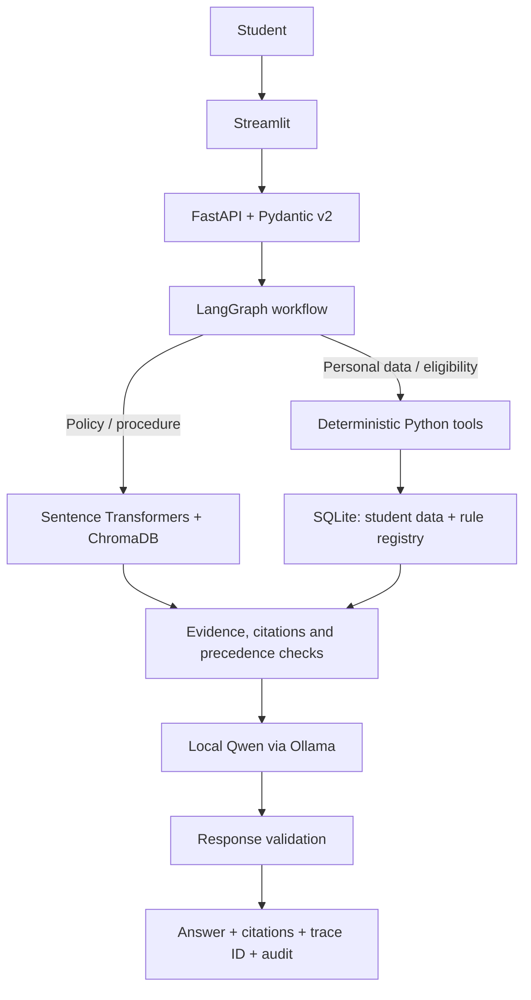

# TrueStack — AI-Powered University Student Services Assistant

**HCLTech Future Ready AI Engineer Hackathon**  
Local-first RAG + deterministic tools + one LangGraph workflow.

> **Demo data warning:** The student records bundled with this project are fictional. Two bundled policy documents are marked **SYNTHETIC DEMO — NOT OFFICIAL DTU POLICY**. They exist to demonstrate gaps, rule activation and policy-version handling. They must not be used for real academic decisions.

## What it does

- Answers ordinary general-knowledge and programming questions directly with local Qwen.
- Answers university-policy questions from indexed documents with source/page/version/effective-date citations.
- Uses Sentence Transformers and persistent ChromaDB for retrieval.
- Uses SQLite and deterministic Python tools for student records, attendance, results and source-linked rules.
- Applies document applicability and precedence (scope, effective dates, explicit supersession, authority and recency).
- Refuses cross-student record requests before calling personal-data tools.
- Supports missing-evidence responses, clarification, unresolved-conflict reporting and multi-step what-if questions.
- Accepts documents through `POST /ingest` while running, without re-embedding the whole corpus on startup.
- Keeps indexing and calculation-rule activation separate: a new number in a PDF cannot automatically become an active eligibility threshold.
- Uses a local Qwen model through Ollama for general answers and evidence-grounded policy explanations when `MOCK_LLM=false`; mock mode is only for pipeline smoke tests.

## Architecture



One controlled workflow is intentional. Retrieval, Python tools, rule resolution and response validation are workflow components, not autonomous agents.

## Supplied DTU source documents

The local bundle includes the original three PDFs under `data/documents/official/`, together with page-anchored extracted text under `data/extracted/`:

1. B.Tech Ordinance / Regulations / Scheme of Teaching & Examinations — B.Tech Program 2025. Official index: <https://www.dtu.ac.in/Web/Academics/ordinance.php>
2. Examination eligibility notice for Odd Semester AY 2026–27, dated 24 August 2026: <https://exam.dtu.ac.in/Notices/Notice_Studnt_O26_240826.pdf>
3. Placement Policy 2025–26, issued 3 July 2025 for the 2025–26 passing-out batch: <https://tnp.dtu.ac.in/docs/policy.pdf>

The Ordinance and examination notice are scans; their text sidecars were OCR-processed. OCR can contain errors, so check a cited page in the supplied PDF before treating a clause as authoritative in real academic decisions. The placement policy says company-specific CGPA cutoffs are set by companies; it does not define a universal cutoff for all students.

For a Git clone, large original PDFs are not stored in Git history. Page-anchored extracted text sidecars are included for the examination notice and placement policy; the public repository contains a focused OCR-derived excerpt of the 143-page ordinance covering the clauses used by the demo. The separate downloadable local bundle retains all three original PDFs and the complete OCR text sidecar. If you clone only the Git repository and need broader ordinance coverage, place the original PDF or a text-readable extract in the local project and ingest it through the app.

## Requirements

- Python 3.11 or 3.12 recommended.
- Docker Desktop with Docker Compose, or a local Python environment.
- Internet access for the first installation and embedding-model download unless the packages/model are already cached.
- Ollama and the configured model for real LLM inference; mock mode does not require Ollama.
- Tesseract and Poppler are used for OCR of scanned uploads. Already-extracted bundled sidecars do not need OCR again.

A GPU is not required. Actual speed depends on hardware; no latency guarantee is claimed.

## Quick start with Docker

1. Install and start Docker Desktop.
2. Install Ollama locally if you want real LLM responses. Pull the model:

   ```bash
   ollama pull qwen2.5:7b-instruct
   ```

3. In the project root, copy `.env.example` to `.env`. The default `MOCK_LLM=true` is for quick smoke tests. For a real local-model run set `MOCK_LLM=false` after Ollama and the model are ready.
4. Start the app:

   ```bash
   docker compose up --build
   ```

5. Open:
   - Streamlit UI: <http://localhost:8501>
   - API docs: <http://localhost:8000/docs>
   - Health: <http://localhost:8000/health>

General questions are classified to Qwen directly and do not run policy retrieval. University-policy questions remain on the RAG route and must be supported by indexed authorised evidence. Personal records and eligibility use deterministic SQLite/Python tools. The first build downloads Python packages and the embedding model unless they are cached, so it needs network access. Ollama runs on the host by default; Compose uses `host.docker.internal`. Check `.env.example` and `docker-compose.yml` if your system uses different host networking.

Stop using `Ctrl+C`. Persisted SQLite and ChromaDB files stay under `storage/`; uploaded documents stay under `data/documents/`.

## Local Python run (without Docker)

Create and activate an environment, then install packages:

```powershell
# Windows PowerShell
py -3.11 -m venv .venv
.\.venv\Scripts\Activate.ps1
python -m pip install --upgrade pip
pip install -r requirements.txt
Copy-Item .env.example .env
```

On Linux/macOS, use `python3.11 -m venv .venv` and `source .venv/bin/activate`; replace `Copy-Item` with `cp .env.example .env`. For a direct host-Python run (not Docker), set `OLLAMA_BASE_URL=http://localhost:11434` in `.env`; `host.docker.internal` is the Docker-container address for reaching Ollama on the host.

For scanned uploads, install Tesseract OCR and Poppler utilities. Use the supplied text sidecars for the initial corpus.

Initialise the database and index bundled source text:

```bash
python scripts/bootstrap.py
```

Generate/validate the synthetic student data using the configured Ollama model when available (or the bundled AI-authored profile seed fallback), then load it:

```bash
python scripts/generate_students.py --provider auto
python scripts/load_students.py --dir data/test_students/
python scripts/validate_students.py --dir data/test_students/
```

Start the API and UI in two terminals:

```bash
uvicorn app.main:app --host 127.0.0.1 --port 8000
```

```bash
streamlit run frontend/streamlit_app.py --server.port 8501
```

Set `API_BASE_URL=http://127.0.0.1:8000` in `.env` for this local mode if needed.

## Data generation and rule provenance

`data/prompts/student_data_generation_prompt.md` stores the exact prompt. `scripts/generate_students.py` tries the configured Ollama model for profile-only JSON. If Ollama is not available and `--provider auto` is used, it records using the bundled AI-authored synthetic profile seed instead. Programme/batch balancing, course/attendance/results rows and exact edge cases are set by Python and documented in `data/data_card.md` and `reports/data_generation_run.json`. It does not claim the LLM generated the exact boundary values.

The dataset contains at least 30 fictional students, 2 programmes, 2 admission batches, 6 courses, attendance rows and result rows. The data card records edge-case IDs and limitations.

Source-linked rules:
- The 75% B.Tech attendance clause is linked to Ordinance R.1(B).22 (OCR-derived; verify in the original PDF).
- The pass/fail boundary test is linked to the Ordinance grading table; the app does not claim to reproduce the entire relative grading algorithm.
- Placement CGPA/backlog and supplementary scenarios are **synthetic demo rules**, not official DTU policy.

## Policy rule activation flow

Uploading a document adds its text to the searchable corpus; numeric thresholds do not become active automatically.

To propose a candidate rule, provide explicit source ID, clause, parameter, operator, value, scope and effective dates. Then validate and activate:

```bash
python scripts/propose_rule.py --help
python scripts/activate_rule.py --help
```

Review both scripts' required arguments with `--help`. Activation checks the source register and clause reference; no arbitrary number extracted from a PDF is executed as a rule.

## API examples

General policy question:

```bash
curl -X POST http://localhost:8000/ask \
  -H "Content-Type: application/json" \
  -d '{"question":"What does the DTU ordinance say about minimum attendance?","as_of_date":"2026-10-23"}'
```

Personal attendance (the ID must be request context, not question text):

```bash
curl -X POST http://localhost:8000/ask \
  -H "Content-Type: application/json" \
  -H "X-Student-Id: S1001" \
  -d '{"question":"What is my attendance in CS201?","as_of_date":"2026-10-23"}'
```

Other endpoints:

```bash
curl http://localhost:8000/health
curl http://localhost:8000/sources
curl http://localhost:8000/audit/TRACE_ID_HERE
```

`POST /ingest` accepts a multipart `file` and `metadata` JSON field matching the Annex B Source Register schema. The Streamlit ingestion panel sends the same request format.

## Evaluation and tests

Run unit/API tests:

```bash
python -m pytest -q
```

The evaluation set has at least 20 cases. Start the API with ChromaDB and the required model/configuration available, then run:

```bash
python scripts/evaluate.py
```

Results are written to `reports/evaluation_report.md` and a JSON details file. Errors/unavailable service calls are recorded as errors, not counted as successful answers. Citation accuracy requires checking the actual cited source passage; automated retrieval and answer-type checks do not replace that review.

## Known limitations

- The full vector-retrieval + Streamlit + real-Ollama integration must be verified in the target local environment. A development environment without installed ChromaDB/Sentence Transformers/Streamlit/Docker cannot validate the complete stack.
- OCR-extracted clauses may contain errors; verify cited source pages visually.
- The 75% rule represents the base attendance threshold; attendance relaxations require authorised evidence and are not automatically granted by this prototype.
- Placement and supplementary demo rules are synthetic and must not be used as official eligibility advice.
- The synthetic grading dataset is not a substitute for the university's full relative-grade determination procedure.
- This prototype uses a student ID header for the hackathon contract; it is not an enterprise authentication system and must not be exposed publicly without proper authentication and deployment security.


